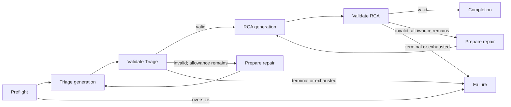

# Minimal Triage → RCA execution v1

This connects the [existing contracts/prompts](agent-contracts.md) and original
[evidence bundles](evidence.md) to a local LangGraph and one OpenAI SDK adapter.
The implementation is verified with mocked HTTP and one complete synthetic live
Triage → RCA smoke. Three retained live attempts ended in HTTP 429, Triage
truncation, then validated completion. This establishes a bounded execution path,
not diagnosis accuracy or research performance. See the
[live qualification report](validation/2026-11-10-live-smoke-three.md) and
[post-failure smoke-budget v2 report](validation/2026-11-10-smoke-budget-v2.md).

## Graph and retry ownership

`src/logquant/agents/workflow.py` defines typed `AgentState`, explicit preflight,
prepare/generate/validate/repair nodes for each agent, and completion/failure.
RCA gets the unchanged original evidence plus Triage validated against that exact
retained bundle. Failed Triage stops execution. A failed RCA retains valid Triage
and its own failed attempts; it never becomes a healthy/diagnosed fallback.



Only graph validation branches repair malformed/citation-invalid model content.
Default is one repair per agent: at most four generation dispatches per candidate.
SDK `max_retries=0`, HTTP transport retries zero, redirects off and no LangGraph
node RetryPolicy prevent nested retry loops. Rate limits, provider errors,
refusals, truncated output, malformed provider envelopes and timeouts are terminal.
Cancellation is explicit; external task cancellation can interrupt routing, so the
wrapper retains the completed/in-flight attempt journal and terminal state.
No remote graph, checkpointer, tool execution or tracing is used. LangSmith
tracing is disabled even when environment variables enable it.

## Provider/profile and official sources

No provider/model was previously selected. The added adapter uses OpenAI Chat
Completions, text-only strict JSON schema and explicit snapshot
`gpt-5.4-mini-2026-03-17`. It is a bounded smoke profile, not an empirical research
model-quality choice. The official [model page](https://developers.openai.com/api/docs/models/gpt-5.4-mini)
records Chat Completions/structured-output support, reasoning `none`, a 400000
context window and 128000 maximum output. The application uses much smaller caps.
Other model IDs/aliases fail until explicitly profiled; live mode has no model
default. The third synthetic live attempt returned this snapshot for both agents
and passed local Triage/RCA schema and citation validation on that one case.

The [Structured Outputs guide](https://developers.openai.com/api/docs/guides/structured-outputs?api-mode=chat)
requires object properties to be required and additional properties disabled.
`provider.strict_schema` removes defaults, makes fields required, maps constants
to enums and omits string-length wire constraints outside the documented subset.
Local Pydantic validators still enforce all response invariants, followed by exact
retained-citation checks. A server-valid JSON shape is not a supported diagnosis.
The [Chat Completions reference](https://developers.openai.com/api/reference/resources/chat/subresources/completions/methods/create)
defines `max_completion_tokens`, finish reasons and reported usage. Requests use
one completion, `reasoning_effort: none`, `store: false`, no tools or streaming.
The third live attempt completed both structured responses and passed the
unchanged local schema/citation checks; semantic support is separately reviewed
in the live qualification report.

The [official Python SDK guide](https://developers.openai.com/api/reference/python)
documents automatic retries, request IDs and configurable timeouts. This adapter
disables retries explicitly and uses both SDK timeout and a local async deadline.
The pinned SDK 3.49.0 uses `httpx2`; LangGraph's dependencies also require `httpx`.
See [LangGraph's graph API](https://docs.langchain.com/oss/python/langgraph/graph-api)
for typed state and conditional routing. Neither a LangChain provider wrapper nor
an additional agent framework was added.

## Admission and accounting

`ConservativeCounter` uses tiktoken's `o200k_base` mapping for this snapshot. It
counts the actual wire JSON with messages, instructions, evidence, Triage, repair
feedback and transformed response schema, then adds **25% plus 1024 tokens** for
unknown server framing/schema overhead. This is a disclosed conservative
**heuristic estimate**, not an exact server token count or a formal upper bound.
The counter identity and `input_count_is_estimate` flag preserve that distinction.
The existing RCA preflight reserve and full actual/repair recount remain in force.
No evidence or repair output is silently truncated.

Runtime never fetches tokenizer data. Setup separately caches a public vocabulary
with SHA-256 `446a9538cb6c348e3516120d7c08b09f57c36495e2acfffe59a5bf8b0cfb1a2d`;
missing/corrupt cache fails before dispatch. Bootstrap is a dependency-data
 download, not a model call. Before live use compare actual provider input usage
with admission estimates; an underestimate stops further generation and requires
requalification rather than silently adjusting policy. Output caps are enforced
by the request; any reported cap violation is terminal. Visible output, reasoning
and cached-input token details are retained where supplied.

Each attempt records model/profile, prompt/schema versions, wire-schema hash,
client UUID, provider request/response/model IDs, local monotonic latency,
finish/terminal status, original model text/refusal, reported usage and validation
errors. Every failed/repaired call counts toward caps. SDK error bodies/headers
and exception strings are excluded because authentication errors can echo keys.
`OPENAI_API_KEY` is read only for explicit live mode and never serialized. The
base URL is fixed to the official API; proxy/environment base-URL overrides are
not supported by this narrow adapter.

Usage missing from a dispatched attempt is **null/unknown**, never zero.
`known_*` fields are subtotals only; complete totals stay null if any attempt's
usage is unknown. Mock usage is flagged synthetic. Cost is not estimated
(`estimated_cost_usd: null`), and no pricing assumption is mixed with token usage.
Measured transport/graph elapsed time in mock mode is local execution time, not
model latency. Local timeout/cancellation does not guarantee the provider stopped
processing or billing. Hard process/host loss is not durably journaled: attempts
are persisted on normal, failed or cooperative-cancel completion, without replay.

## Recreate the analysis environment

The complete 53-distribution analysis/build/test wheel lock is
`requirements-analysis.lock`; prior files are retained in `dependency-history/`.
Numerical/Pydantic pins are unchanged. New direct pins: OpenAI 3.49.0, LangGraph
1.2.20, tiktoken 0.14.0, httpx2 2.16.0. The resolved ARM64/Python 3.13 wheels target
this Mac; the orjson wheel requires macOS 15+. Qualification used macOS 15.5 and
CPython 3.13.5. Other platforms need their own lock/qualification. Fixture locks,
containers, source and retained logs remain untouched.

```sh
/opt/anaconda3/bin/python -m venv .venv
.venv/bin/python -m pip install --require-hashes --no-deps -r requirements-analysis.lock
.venv/bin/python -m pip install --no-deps --no-build-isolation -e .
.venv/bin/python scripts/cache_analysis_tokenizer.py
.venv/bin/python -m pip check
.venv/bin/python -m pytest -q
```

Tokenizer bootstrap requires network only if its ignored `.analysis-cache/`
resource is absent. Hash mismatch refuses overwrite. `scripts/lock_analysis.py
--output-dir NEW_DIRECTORY` stages any future reviewed replacement without
clobbering the current lock. Old fitted model files remain intact; their strict
dependency/source checks intentionally reject changed analysis environments.

## Offline CLI (executed)

Use the previously generated synthetic evidence or reproduce it via evidence.md.
Generate SDK HTTP fixtures with no live/model calls:

```sh
.venv/bin/python scripts/make_mock_agent_responses.py \
  results/evidence/synthetic-v1/bounded results/workflow/demo-http.json --http
.venv/bin/logquant-agents-run results/evidence/synthetic-v1/bounded \
  --mock-http results/workflow/demo-http.json --output-dir results/workflow/demo
```

Default mode requires `--mock-http` and uses the **real adapter/SDK/graph** over
`httpx2.MockTransport`. It never reads the real API key. Mock event statuses cover
completion, refusal, truncation, rate limit, error, timeout, cancellation and
malformed envelope. `--budget` accepts the existing execution contract. The
original `logquant-agents-mock` remains an offline contract-only demonstration.

The execution CLI accepts available **synthetic-only** evidence for this milestone
and one candidate per invocation; use `--candidate-id` when multiple bundles exist.
No candidates dispatches nothing. Invalid/unavailable evidence is rejected.
Outputs are separate `workflow.json` and `run-report.json`; sources/configs cannot
be overwritten, existing outputs require `--overwrite`, symlinks are rejected.
Output availability is checked before dispatch. Individual files are atomic;
output groups are not crash-atomic. Exit 0 means validated/no candidate, 1 means
rejected input/config/output, 3 means retained processing/cancellation failure.
Execution UUIDs/latencies intentionally vary; request bodies and routing under
fixed mock events remain deterministic.

## One-candidate live smoke — post-failure budget v2

Required environment: **OPENAI_API_KEY**, populated outside source/artifacts.
The explicit model flag is mandatory. Preserve `live-smoke-one/` (HTTP 429) and
`live-smoke-two/` (Triage truncated at 512 output tokens) and their original
`configs/live-smoke-budget.json`; do not rerun into either directory.

`configs/live-smoke-budget-v2.json` is a **post-failure synthetic smoke revision,
not a frozen research configuration**. It allows **2048 output tokens per agent**,
**4096** for Triage in RCA input, estimated input cap **12000**, and unchanged
context **16384**. Maximum **two generation calls**, no repairs or transport/SDK/
graph retries, and **30 seconds per call** remain unchanged. Model, prompts,
schemas, evidence and validation are unchanged. These caps do not guarantee
complete output, latency or exact cost.

The larger reserve allows heuristic room for Triage being serialized into the
RCA JSON and for the existing counter's 25% margin. RCA base estimate **6207** +
reserve **4096** = **10303** input; plus **2048** output = **12351**. The old input
cap 10000 would reject this, hence 12000; configured input plus output is **14048**,
within context 16384. Actual Triage content and the full RCA request are still
recounted before RCA dispatch and rejected if they cannot fit. No truncation or
validation bypass was added. See the [detailed report](validation/2026-11-10-smoke-budget-v2.md)
for rationale, hashes, mock checks and retained live usage.

Offline qualification, already executed with near-cap complete canned responses:

```sh
.venv/bin/logquant-agents-run results/evidence/synthetic-v1/bounded \
  --mock-http results/workflow/smoke-budget-v2/near-cap-http.json \
  --budget configs/live-smoke-budget-v2.json \
  --output-dir results/workflow/smoke-budget-v2/installed-cli
```

That output directory exists; preserve it. Use a new output directory for any
local repetition. The fixtures are synthetic-only transport/budget checks and
are not model predictions.

The user executed the following v2 command once; preserve its existing outputs.
This is the recorded command, not an instruction to rerun it:

```sh
cd /Users/eddieanokye/LogQuant
.venv/bin/logquant-agents-run results/evidence/synthetic-v1/bounded \
  --live --model gpt-5.4-mini-2026-03-17 --budget configs/live-smoke-budget-v2.json \
  --output-dir results/workflow/live-smoke-three
```

This v2 command completed with `validated`, two attempts: 3580/1381 Triage and
5021/1023 RCA input/output tokens; workflow 14.692 seconds. Both returned the
configured snapshot and `finish_reason=stop`. RCA ran only after valid Triage;
no repair or rerun occurred. The [report](validation/2026-11-10-live-smoke-three.md)
separates citation/schema validity from plausible but unproven causal reasoning.
The synthetic smoke does not establish research performance, diagnosis accuracy
or injection safety. Next prioritize staged healthy training/development collection
and detector verification on real fixture logs; no collection occurred here.
